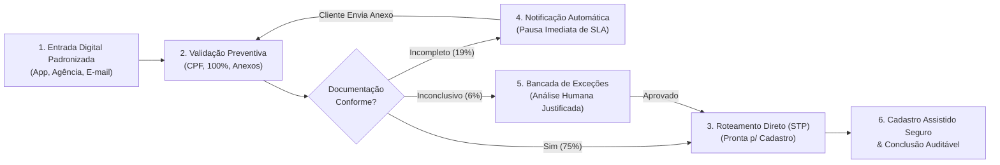
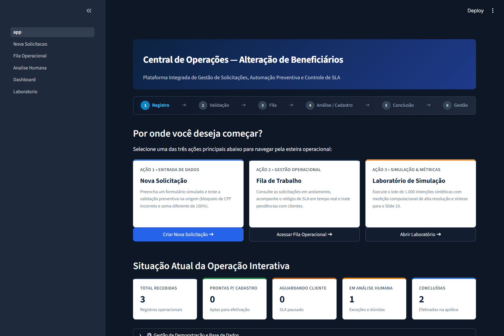
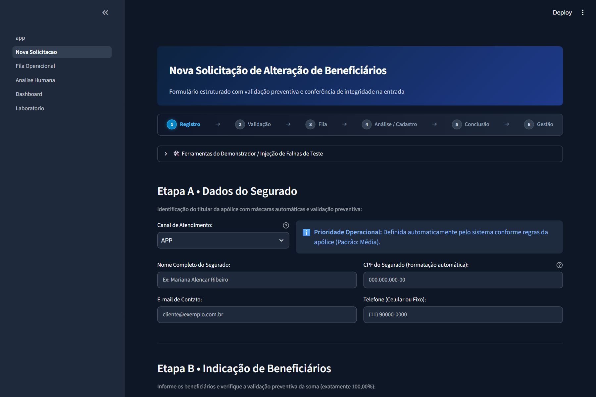
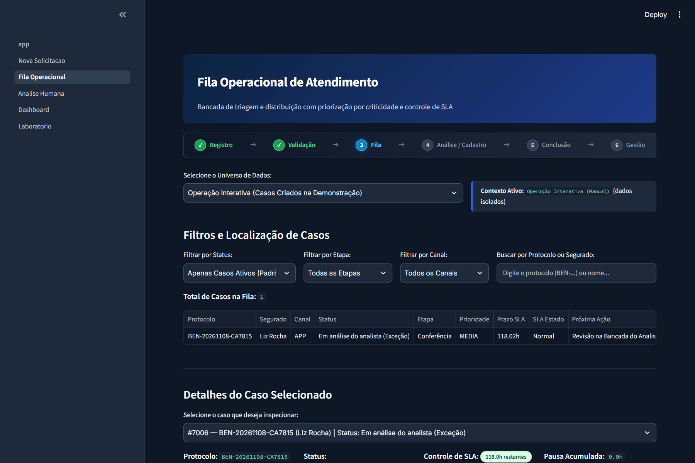
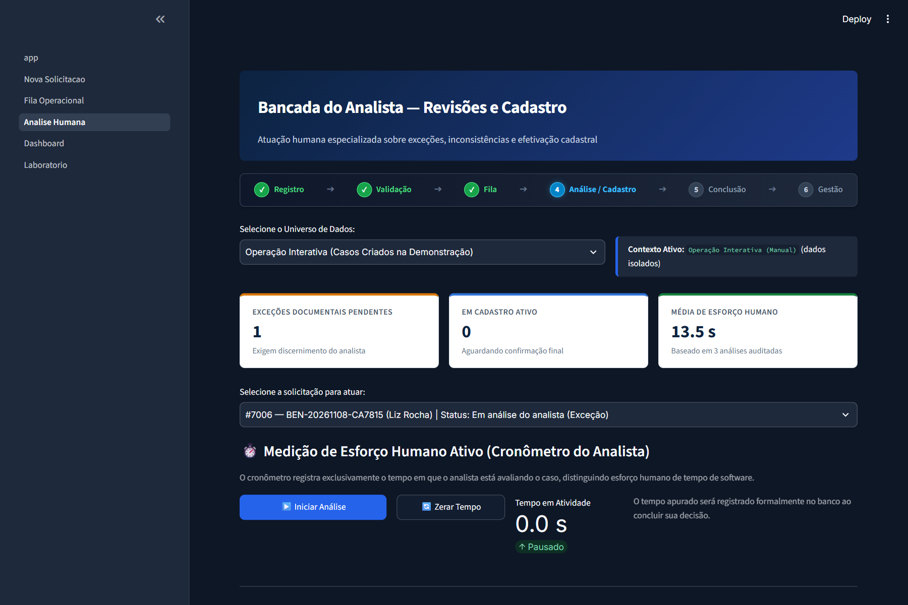
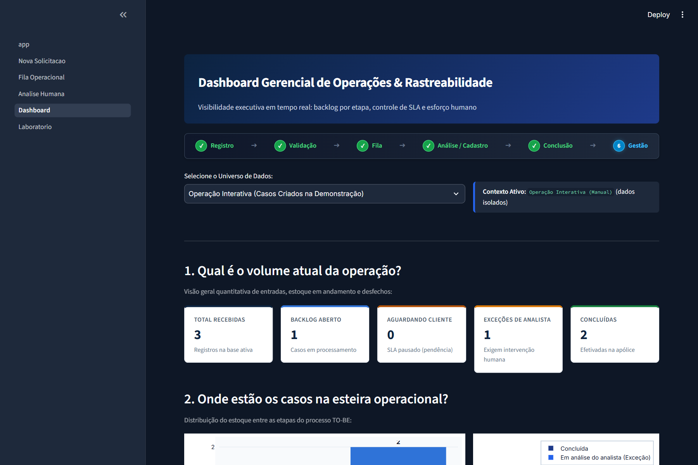
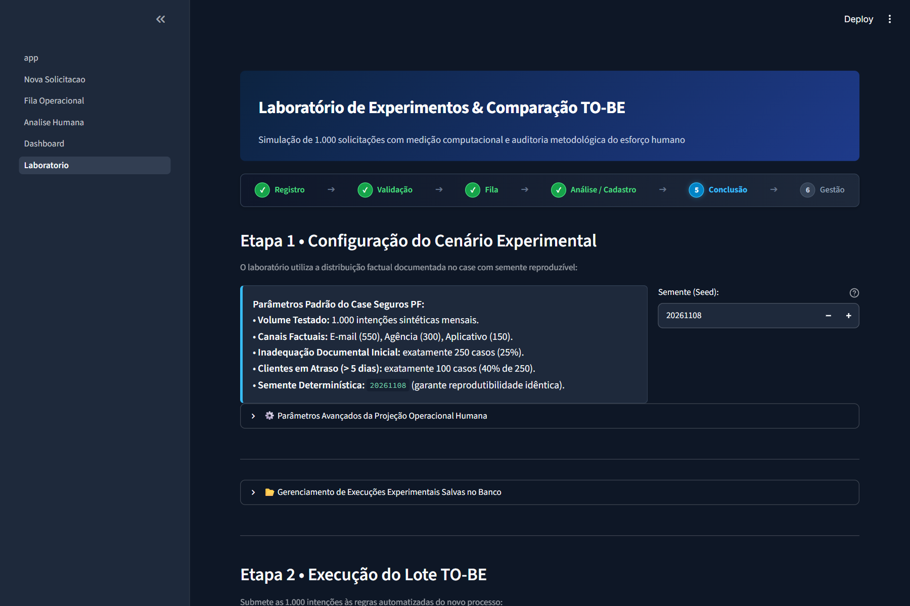

# case-dados-automacao-beneficiarios

> **Plataforma Integrada de Gestão de Solicitações, Automação Preventiva e Controle de SLA para Alteração de Beneficiários — Seguros PF (Modelo TO-BE)**

[](https://www.python.org/downloads/)
[](https://streamlit.io/)
[](https://www.sqlite.org/)
[-brightgreen.svg)](https://docs.pytest.org/)
[](LICENSE)

---

## 1. Apresentação e Resumo Executivo

O **`case-dados-automacao-beneficiarios`** é uma prova de conceito (PoC) de engenharia de software, automação de processos e análise de dados desenvolvida para simular a transformação operacional do processo de **alteração de beneficiários de seguros de pessoas físicas**.

O projeto materializa a especificação do cenário futuro (**TO-BE**), substituindo o modelo analógico e reativo por uma arquitetura digital padronizada, orientada a dados, com validação preventiva na entrada (*Shift-Left*), triagem automática (*Straight-Through Processing - STP*), fila operacional priorizada por criticidade de SLA e atuação humana focada estritamente sobre exceções complexas (*Human-in-the-Loop*).

> [!NOTE]
> **Natureza Educacional e Demonstrativa**  
> Este projeto constitui um estudo de caso técnico desenvolvido para fins acadêmicos e avaliação em processo seletivo de estágio. Utiliza **exclusivamente dados sintéticos** e não possui conexão com ambientes bancários de produção nem utiliza dados reais de segurados.

---

## 2. O Problema de Negócio (Cenário Legado AS-IS)

No fluxo operacional histórico (**AS-IS**), as solicitações de alteração de beneficiários chegavam por múltiplos canais fragmentados (e-mails com texto livre, formulários escaneados nas agências e balcão):

- **Ausência de Crítica na Origem:** Erros grosseiros de digitação (CPFs matematicamente inválidos e percentuais de participação que não totalizavam 100%) só eram percebidos dias após o envio.
- **Inadequação Documental Excessiva:** **25% de todas as solicitações** (250 em cada 1.000 mensais) apresentavam documentos ilegíveis ou certidões obrigatórias ausentes.
- **Triagem Manual Morosa:** Analistas abriam anexo por anexo manualmente para identificar dados básicos da apólice e do segurado.
- **Extrapolação de Prazos e Falta de Rastreabilidade:** O relógio de SLA regulamentar continuava correndo enquanto a seguradora aguardava o retorno do cliente, gerando atritos operacionais e cerca de 18 reclamações mensais na Ouvidoria.
- **Esforço Operacional Repetitivo:** A operação consumia **313,33 horas humanas por mês** de uma equipe especializada de 3 analistas seniores em tarefas operacionais manuais.

---

## 3. A Solução Proposta (Cenário TO-BE)

A solução transforma a jornada do segurado e a operação interna em cinco pilares fundamentais:



1. **Shift-Left:** Interceptação imediata de CPFs inválidos e bloqueio de submissões com somas divergentes de 100,00% antes da transmissão.
2. **Processamento Direto (STP):** Casos regulares com documentação íntegra avançam diretamente para efetivação sem triagem manual.
3. **Pausa Regulamentar de SLA:** Desconto automático no cálculo do prazo líquido enquanto a solicitação estiver aguardando complemento do segurado.
4. **Bancada do Analista:** Interface ergonômica com parecer prévio da automação, cronômetro de esforço humano ativo e gravação de justificativa obrigatória.
5. **Cadastro Assistido com Rastreabilidade Total:** Bloqueio de encerramento de solicitações sem confirmação explícita de efetivação cadastral.

---

## 4. Demonstração Visual e Funcionalidades

### 4.1 Central de Operações
Painel de entrada com a jornada operacional completa de 6 etapas, atalhos rápidos e resumo executivo dos universos de dados.



---

### 4.2 Nova Solicitação de Alteração
Formulário digital padronizado com verificação algorítmica de CPF (módulo 11), balanceamento dinâmico de percentuais de beneficiários e gerador de perfis fictícios válidos para demonstração imediata.



---

### 4.3 Fila Operacional Priorizada
Visão unificada da esteira com seletor estrito de universo de dados (Operação Interativa vs Simulação Experimental), badges de estado de SLA com alto contraste (WCAG AA) e roteamento de 1 clique para a bancada do analista.



---

### 4.4 Bancada do Analista (Exceções e Cadastro Assistido)
Ambiente de trabalho humano especializado. Apresenta o parecer automatizado do sistema, cronômetro de esforço ativo, tratamento de pendências e gravação transacional de decisões justificadas.



---

### 4.5 Dashboard Gerencial e Rastreabilidade
Indicadores operacionais em tempo real: distribuição por canal, status, prioridade, tempo médio de intervenção humana e controle rigoroso de SLA (separação entre solicitações ativas e concluídas).



---

### 4.6 Laboratório de Experimentos (1.000 Casos Sintéticos)
Ambiente de simulação em lote determinístico com semente oficial (`20261108`). Exibe a síntese comparativa AS-IS vs TO-BE, detalhamento dos 77 erros evitados e gerenciador transacional de execuções salvas.



---

## 5. Arquitetura Técnica e Engenharia de Dados

O projeto foi estruturado seguindo os princípios de separação de responsabilidades (*SoC*), transações ACID no SQLite e portabilidade total:

```text
case-dados-automacao-beneficiarios/
│
├── app.py                      # Ponto de entrada (Central de Operações)
├── pages/                      # Módulos operacionais do Streamlit
│   ├── 01_Nova_Solicitacao.py  # Entrada padronizada e crítica preventiva
│   ├── 02_Fila_Operacional.py   # Triagem, priorização e roteamento
│   ├── 03_Analise_Humana.py    # Bancada do analista e cadastro assistido
│   ├── 04_Dashboard.py         # Métricas operacionais, SLA e gráficos WCAG AA
│   └── 05_Laboratorio.py       # Simulação determinística de 1.000 intenções
│
├── src/                        # Camada de domínio, serviços e dados
│   ├── config.py               # Constantes factuais do case e caminhos
│   ├── database.py             # Schema SQLite DDL, migrações e índices
│   ├── models.py               # Dataclasses e Enums canônicos
│   ├── repositories.py         # Camada de persistência relacional transacional
│   ├── validators.py           # Regras algorítmicas (CPF módulo 11, soma 100%)
│   ├── workflow.py             # Máquina de estados e avanço de etapas
│   ├── sla.py                  # Motor de cálculo de SLA líquido com pausa
│   ├── synthetic_data.py       # Gerador determinístico PRNG (seed 20261108)
│   ├── simulation.py           # Motor de simulação em lote e benchmarking
│   ├── metrics.py              # Consolidação comparativa AS-IS vs TO-BE
│   ├── notifications.py        # Mensageria e templates para clientes
│   ├── seed_data.py            # Utilitário de inicialização rápida
│   └── ui_helpers.py           # Design system corporativo e seletores
│
├── tests/                      # Suíte de 35 testes automatizados (Pytest)
│   ├── test_database.py
│   ├── test_functional_scenarios.py
│   ├── test_generator.py
│   ├── test_pages_regression.py
│   ├── test_simulation.py
│   ├── test_sla.py
│   ├── test_universe_isolation.py
│   ├── test_validators.py
│   └── test_workflow.py
│
├── docs/                       # Documentação técnica aprofundada
│   ├── arquitetura.md
│   ├── processo-as-is-to-be.md
│   ├── metodologia-simulacao.md
│   ├── regras-de-negocio.md
│   └── limitacoes.md
│
├── assets/                     # Evidências visuais e capturas reais
│   └── screenshots/
│
├── scripts/                    # Scripts utilitários de suporte e automação
│   └── capture_screenshots.py  # Captura automatizada via Playwright/Edge
│
├── .streamlit/                 # Configuração oficial do servidor
│   └── config.toml
├── .gitignore                  # DevSecOps e exclusão de dados sensíveis
├── .env.example                # Configurações de ambiente opcionais
├── requirements.txt            # Dependências mínimas auditadas
├── LICENSE                     # Licença MIT
└── README.md                   # Documentação executiva
```

---

## 6. Resultados do Experimento e Rigor Metodológico

A execução do lote de 1.000 intenções sintéticas no Laboratório com a semente oficial `20261108` demonstrou os seguintes resultados auditados:

### 6.1 Volumetria e Decomposição do Lote
- **Total de Intenções Sintéticas:** 1.000 casos
- **Distribuição por Canal:** 550 E-mail (55%) | 300 Agência (30%) | 150 App (15%)
- **Casos Aptos para Processamento Direto (STP):** 750 casos (75,0%)
- **Casos com Documento Ausente (Aguardando Cliente):** 190 casos (19,0%)
- **Casos com Legibilidade Inconclusiva (Exceção Humana):** 60 casos (6,0%)
- **Erros Sintéticos Prevenidos Preventivamente:** 77 erros

### 6.2 Comparativo de Esforço Operacional Humano
- **Cenário AS-IS de Referência:** 313,33 horas humanas/mês (3 analistas dedicados)
- **Cenário TO-BE Projetado:** **40,25 horas humanas/mês** (apenas 60 exceções + 750 cadastros assistidos rápidos + 15 min de auditoria residual)
- **Redução Projetada de Esforço Operacional:** **-87,2%**

### 6.3 Desempenho Computacional Local
- **Tempo Computacional de Processamento:** **0,221 segundo** (para triar e validar 1.000 registros na CPU local)
- **Vazão Computacional:** **~4.534 registros por segundo**

> [!WARNING]
> **Ressalvas e Diferenciações Metodológicas Importantes:**
> 1. O tempo computacional de 0,221s refere-se estritamente à execução lógica das regras de validação em memória na CPU local, não equivalendo à conclusão operacional de um processo bancário completo.
> 2. O esforço humano projetado de 40,25 horas/mês decorre das premissas operacionais factuais modeladas na especificação do case e deve ser revalidado empiricamente em ambiente real de produção.
> 3. Os 750 casos STP foram classificados como *aptos para cadastro*, dependendo da integração final com o sistema bancário central.

---

## 7. Como Executar Localmente

### 7.1 Pré-requisitos
- Python 3.10 ou superior (testado e homologado em Python 3.14.3)
- Gerenciador de pacotes `pip` ou [`uv`](https://github.com/astral-sh/uv) (recomendado)
- Git instalado

### 7.2 Instalação Passo a Passo

1. **Clonar o Repositório:**
   ```bash
   git clone https://github.com/pedro-caputo/case-dados-automacao-beneficiarios.git
   cd case-dados-automacao-beneficiarios
   ```

2. **Criar e Ativar o Ambiente Virtual:**
   ```bash
   # Com uv (recomendado - ultrarrápido):
   uv venv .venv
   .venv\Scripts\activate   # Windows
   # source .venv/bin/activate # Linux/macOS

   # Ou com venv padrão:
   python -m venv .venv
   .venv\Scripts\activate
   ```

3. **Instalar as Dependências:**
   ```bash
   # Com uv:
   uv pip install --link-mode=copy -r requirements.txt

   # Ou com pip padrão:
   pip install -r requirements.txt
   ```

4. **Inicializar o Banco de Dados com Casos Demonstrativos:**
   ```bash
   python -m src.seed_data
   ```
   *Este comando cria o banco SQLite limpo, gera as 1.000 intenções brutas, cria os 3 casos interativos de referência e roda o lote de 1.000 casos da semente 20261108.*

5. **Iniciar a Aplicação Streamlit:**
   ```bash
   streamlit run app.py
   ```
   Acesse a plataforma no navegador em **`http://localhost:8501`**.

---

## 8. Execução da Suíte de Testes Automatizados

O projeto conta com **35 testes automatizados** cobrindo todas as regras de negócio críticas, integridade relacional do banco, validações algorítmicas, isolamento entre universos e ciclo de vida de telas:

```bash
pytest -v
```

### Resumo da Cobertura de Testes:
```text
tests/test_database.py ......................... [  8%]  (Schema, DDL, integridade referencial)
tests/test_functional_scenarios.py ............. [ 28%]  (Cenários ponta a ponta A até G)
tests/test_generator.py ........................ [ 37%]  (PRNG, reprodutibilidade, CPFs válidos)
tests/test_pages_regression.py ................. [ 54%]  (Ciclo de vida AppTest das 6 páginas)
tests/test_simulation.py ....................... [ 60%]  (Execução em lote de 1.000 casos)
tests/test_sla.py .............................. [ 62%]  (Cálculo líquido e pausa de 120 horas)
tests/test_universe_isolation.py ............... [ 74%]  (Isolamento Interativo vs Experimental)
tests/test_validators.py ....................... [ 91%]  (Algoritmo CPF módulo 11, soma 100%)
tests/test_workflow.py ......................... [100%]  (Máquina de estados e transições)

============================= 35 passed in 9.64s =============================
```

---

## 9. Segurança, Privacidade e DevSecOps

- **Proteção de Informações Sensíveis:** Nenhuma credencial, senha, chave privada ou token de API é versionado.
- **Privacidade por Design (LGPD):** 100% dos nomes, telefones, e-mails e CPFs utilizados são fictícios e gerados por algoritmos sintéticos.
- **Isolamento de Base de Dados:** O arquivo operacional `data/beneficiarios.db` está expressamente bloqueado no `.gitignore`. O repositório contém utilitários para gerar bases novas reproduzíveis a qualquer momento.

---

## 10. Integração com Outros Projetos e Próximos Passos

Este repositório compõe o **Pilar 1 (Arquitetura Pro-Code Python)** de um estudo comparativo abrangente:

1. **`case-dados-automacao-beneficiarios`** (Este repositório): Protótipo funcional em Python, Streamlit e SQLite demonstrando regras de negócio, SLA e simulação de 1.000 casos.
2. **`case-beneficiarios-power-platform`** (Em desenvolvimento): Arquitetura alternativa Low-Code modelada em Microsoft Power Apps, Power Automate, SharePoint/Dataverse e Power BI.
3. **`case-beneficiarios-visao-geral`** (Em desenvolvimento): Repositório executivo integrador com documentação consolidada, análise comparativa TCO/ROI e apresentações executivas.

---

## 11. Aviso Institucional e Legal

Este projeto é uma **iniciativa independente, técnica e educacional**, desenvolvida para demonstrar competências práticas em automação de processos, engenharia de software e análise de dados.

- **Não representa um produto, sistema ou posição oficial do Itaú Unibanco.**
- **Não utiliza sistemas de produção, infraestrutura interna ou dados reais de segurados.**
- O uso de termos do setor bancário e securitário dá-se exclusivamente em caráter contextual e demonstrativo.

---

## 12. Licença

Este projeto é distribuído sob os termos da licença **MIT**. Consulte o arquivo [LICENSE](LICENSE) para obter detalhes.
