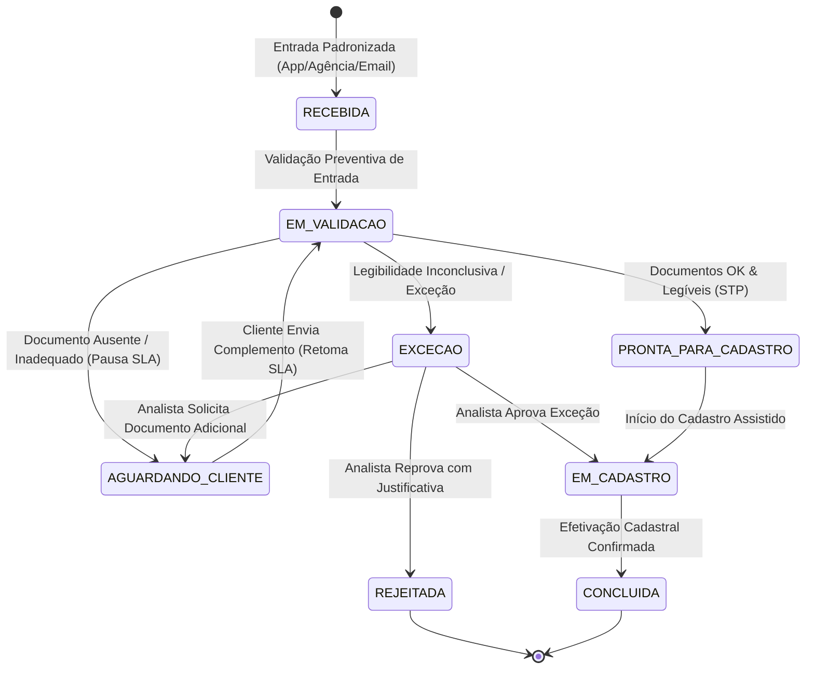

# Arquitetura de Software e Engenharia da Solução

Este documento detalha as decisões arquiteturais, o modelo de camadas, a gestão de dados e o fluxo de controle da aplicação **Gestão de Alteração de Beneficiários — Seguros PF (Modelo TO-BE)**.

---

## 1. Visão Geral da Arquitetura

A solução adota uma arquitetura em camadas orientada a serviços (*Layered Service Architecture*), implementada em Python 3.14+, com interface reativa via Streamlit e persistência transacional local em SQLite.

```
┌───────────────────────────────────────────────────────────┐
│               Camada de Apresentação (Streamlit)          │
│   app.py (Central) | 01_Nova_Solicitacao | 02_Fila        │
│   03_Analise_Humana | 04_Dashboard | 05_Laboratorio       │
└─────────────────────────────┬─────────────────────────────┘
                              │
┌─────────────────────────────▼─────────────────────────────┐
│                 Componentes de UX & Design System         │
│   src/ui_helpers.py (Stepper, Badges WCAG AA, Modais)     │
└─────────────────────────────┬─────────────────────────────┘
                              │
┌─────────────────────────────▼─────────────────────────────┐
│                 Camada de Domínio e Serviços              │
│   src/workflow.py      (Máquina de estados e transições)  │
│   src/validators.py    (Validação preventiva de regras)   │
│   src/sla.py           (Cálculo líquido com pausa/retomada)│
│   src/simulation.py    (Motor computacional de lote)      │
│   src/synthetic_data.py(Gerador determinístico PRNG)      │
│   src/metrics.py       (Consolidação AS-IS vs TO-BE)      │
│   src/notifications.py (Mensageria e templates)           │
└─────────────────────────────┬─────────────────────────────┘
                              │
┌─────────────────────────────▼─────────────────────────────┐
│             Camada de Acesso a Dados (Repository)         │
│   src/repositories.py  (Transações ACID, isolamento)      │
│   src/database.py      (Schema DDL, índices, migrações)   │
│   src/models.py        (Dataclasses, Enums de domínio)    │
└─────────────────────────────┬─────────────────────────────┘
                              │
┌─────────────────────────────▼─────────────────────────────┐
│                   Persistência (SQLite)                   │
│   data/beneficiarios.db (Chaves estrangeiras ativas)      │
└───────────────────────────────────────────────────────────┘
```

---

## 2. Princípios de Engenharia Adotados

1. **Separação de Responsabilidades (SoC):** As regras de negócio não dependem da interface gráfica; todo o processamento de regras reside em `src/validators.py` e `src/workflow.py`.
2. **Atomicidade e Transacionalidade (ACID):** Operações que envolvem múltiplas tabelas (solicitação, beneficiários, documentos, pendências e eventos) são executadas dentro de blocos de transação explícitos com `conn.commit()` ou `conn.rollback()`.
3. **Isolamento de Contextos (Multi-tenancy Lógico):** O sistema isola de forma rigorosa as solicitações criadas na **Operação Interativa** (testes manuais e casos reais da esteira) daquelas geradas no **Laboratório Experimental** (lote sintético de 1.000 intenções), utilizando uma coluna de partição lógica (`universo`) e índices dedicados.
4. **Rastreabilidade Completa (Audit Trail):** Toda alteração de estado, decisão humana, inclusão de pendência ou envio de comunicação gera um registro imutável na tabela `eventos`.

---

## 3. Modelo de Dados Relacional (SQLite)

O banco de dados utiliza chaves estrangeiras ativas (`PRAGMA foreign_keys = ON;`) com comportamento `ON DELETE CASCADE`.

### Principais Entidades:
- `raw_intents`: Intenções brutas de solicitação geradas pela semente sintética.
- `simulation_runs`: Metadados das execuções em lote no Laboratório (data, semente, duração computacional, horas estimadas).
- `solicitacoes`: Registro estruturado com protocolo único, canal, status, etapa, prioridade, universo, run_id e controle de SLA.
- `clientes`: Dados fictícios do titular do seguro (nome, CPF mascarado, contato).
- `beneficiarios`: Beneficiários indicados, com validação de parentesco e percentual de participação (soma exata de 100,00%).
- `documentos`: Anexos da solicitação com registro de presença, formato sintático e legibilidade simulada.
- `pendencias`: Inconsistências documentais que exigem contato com o cliente, controlando a pausa do relógio de SLA.
- `tarefas`: Tarefas na esteira humana com medição de esforço em segundos (*cronômetro ativo do analista*).
- `eventos`: Linha do tempo auditável com autor, descrição e carimbo de data/hora ISO 8601.
- `comunicacoes`: Notificações simuladas enviadas ao cliente via e-mail, SMS ou push no app.

---

## 4. Máquina de Estados do Processo TO-BE

O ciclo de vida da solicitação é controlado estritamente por enums (`StatusSolicitacao` e `EtapaProcesso`):



---

## 5. Portabilidade e Implantação

- A aplicação é totalmente autossuficiente e funciona em Windows, macOS e Linux.
- Dependências gerenciadas via `requirements.txt` com suporte nativo a `uv` ou `pip`.
- Não requer serviços de nuvem ou bancos de dados externos para execução ou auditoria.
