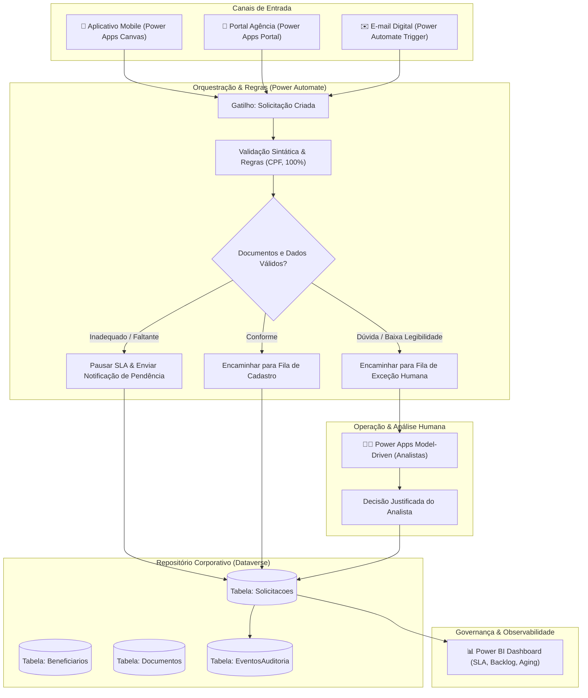

# Arquitetura Conceitual Low-Code — Microsoft Power Platform

Este documento apresenta o mapeamento da solução TO-BE de **Alteração de Beneficiários de Seguros PF** para o ecossistema corporativo **Microsoft Power Platform**, demonstrando como os conceitos implementados no protótipo Python se traduzem em componentes de mercado.

---

## 1. Mapeamento de Componentes (Protótipo vs Power Platform)

| Componente no Protótipo Python | Equivalente Corporativo Low-Code | Responsabilidade e Função |
|---|---|---|
| **Nova Solicitação (`01_Nova_Solicitacao.py`)** | **Power Apps (Canvas App)** | Interface de autoatendimento para clientes/agências com validação de CPF e percentuais em tempo de digitação. |
| **Fila & Análise Humana (`02` e `03`)** | **Power Apps (Model-Driven App)** | Bancada de trabalho dos 3 analistas com gestão de filas, visualização de documentos e decisões estruturadas. |
| **Motor de Regras (`validators.py` / `workflow.py`)** | **Power Automate (Cloud Flows)** | Fluxos automatizados acionados na criação do registro para validação sintática, atribuição de prioridade e pausas de SLA. |
| **Persistência Relacional (`database.py` / SQLite)** | **Microsoft Dataverse** | Banco relacional corporativo com entidades tipadas, integridade referencial, controle de concorrência e segurança por função. |
| **Disparo de Notificações (`notifications.py`)** | **Power Automate + Office 365 Connector** | Envio de e-mails transacionais padronizados com número de protocolo, link de acompanhamento e avisos de pendência. |
| **Dashboard & Métricas (`04_Dashboard.py`)** | **Power BI Service** | Relatórios visuais interativos conectados diretamente às tabelas do Dataverse para monitoramento de SLA e backlog. |

---

## 2. Diagrama de Fluxo e Integração

---

## 3. Avaliação Arquitetural: Dataverse vs SharePoint Lists

| Critério | Microsoft Dataverse (Recomendado) | SharePoint Lists (Alternativa Básica) |
|---|---|---|
| **Integridade Relacional** | Suporte nativo a 1:N (Solicitação ➔ Beneficiários, Eventos) | Frágil; exige colunas de Lookup manuais sem cascata |
| **Segurança e LGPD** | Segurança granular em nível de linha, campo e unidade de negócio | Permissões em nível de lista ou pasta; difícil mascaramento |
| **Volume e Escalabilidade** | Projetado para milhões de registros corporativos | Degradação de performance em listas com mais de 5.000 itens |
| **Pausas de SLA e Cálculos** | Campos calculados e tabelas de feriados/horários operacionais | Exige fluxos complexos em Power Automate para cada pausa |
| **Custo de Licenciamento** | Exige licença Premium (Power Apps por usuário/app) | Já incluso na maioria dos planos Microsoft 365 Standard |

> **Conclusão:** Para uma operação seguradora com 1.000 solicitações/mês e crescimento contínuo de 10% a.a., o **Microsoft Dataverse** é a única opção recomendada que atende às exigências regulatórias, de LGPD e de integridade referencial.

---

## 4. Governança, LGPD e Segurança da Informação

1. **Proteção de Dados Pessoais (LGPD):**
   - Dados sensíveis de segurados e beneficiários (nome, CPF, parentesco) protegidos com criptografia em trânsito e em repouso.
   - Restrição de visualização de CPF completo apenas para o analista responsável pelo caso.
2. **Trilha de Auditoria Imutável:**
   - Cada mudança de estado ou atribuição de analista gera registro gravado no log de eventos com carimbo de data/hora oficial e identificador do usuário do Microsoft Entra ID (antigo Azure AD).
3. **Resiliência e Tolerância a Falhas:**
   - Fluxos do Power Automate configurados com política de repetição automática (*exponential backoff retry*) e encaminhamento a fila de erro monitorada em caso de falha de conexão.

