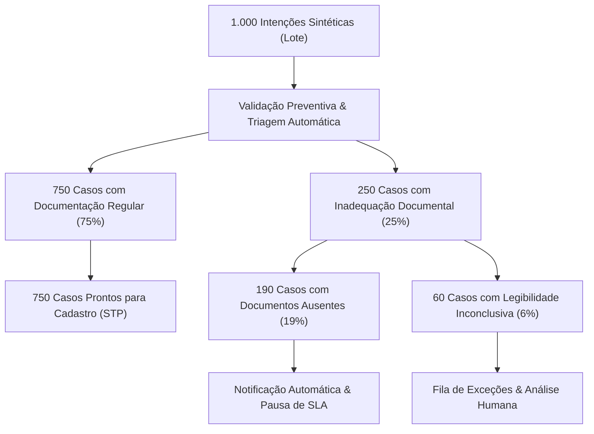

# Metodologia da Simulação e Resultados Experimentais

Este documento descreve os fundamentos estatísticos, a modelagem de dados sintéticos e o rigor metodológico aplicado no **Laboratório de Experimentos** do projeto.

---

## 1. Premissas de Geração Sintética

Para reproduzir com fidelidade a volumetria factual do case corporativo sem expor dados reais de clientes, foi desenvolvido um gerador determinístico de intenções sintéticas (`src/synthetic_data.py`) baseado em gerador de números pseudoaleatórios (PRNG).

### Parâmetros Imutáveis do Modelo:
- **Volume Total:** 1.000 intenções de alteração de beneficiários.
- **Semente Oficial de Reprodutibilidade:** `seed = 20261108`.
- **Distribuição Histórica de Canais de Entrada:**
  - **E-mail:** 550 casos (55,0%)
  - **Agência:** 300 casos (30,0%)
  - **Aplicativo (App):** 150 casos (15,0%)
- **Taxa Global de Inadequação Documental Inicial:** 250 casos (25,0%).
  - **Aguardando Complemento (Documento Ausente):** 190 casos (19,0%).
  - **Exceção Documental (Legibilidade Inconclusiva):** 60 casos (6,0%).
- **Erros Sintéticos Interceptados na Origem:** 77 erros propositais (dígitos verificadores incorretos de CPF, somas parciais de beneficiários divergentes de 100% ou e-mails mal formatados).

---

## 2. Diferenciação Metodológica Fundamental

> [!IMPORTANT]
> **Tempo Computacional vs Tempo Operacional do Processo**
> - **Tempo Computacional (~0,221 segundo):** É o tempo que a CPU local levou para iterar sobre as 1.000 intenções, instanciar objetos em memória, aplicar regras de validação lógica e gravar registros no SQLite local (~4.534 registros/segundo).
> - **Esforço Humano Operacional Estimado (40,25 horas/mês):** É a projeção de tempo que analistas humanos despenderiam ao longo de um mês para realizar as tarefas não automatizáveis (60 exceções x 15 min + 750 cadastros assistidos x 2 min + 15 min de auditoria residual).
> - **Tempo de Ciclo do Processo (SLA de 5 dias):** É a duração total percebida pelo cliente final, desde a emissão do protocolo até a confirmação cadastral, incluindo tempos de espera e eventual envio de documentos pendentes.

---

## 3. Decomposição das 1.000 Intenções na Semente `20261108`

---

## 4. Fórmulas de Cálculo e Projeção

1. **Esforço TO-BE:**
   $$H_{TO-BE} = \frac{(60 \times 15) + (750 \times 2) + 15}{60} = \frac{900 + 1500 + 15}{60} = \frac{2415}{60} = 40,25 \text{ horas/mês}$$

2. **Esforço AS-IS:**
   $$H_{AS-IS} = \frac{(1000 \times 5) + (1000 \times 8) + (250 \times 10) + (750 \times 4) + (150 \times 2)}{60} = \frac{18800}{60} = 313,33 \text{ horas/mês}$$

3. **Redução Percentual de Esforço Operacional:**
   $$\Delta\% = \frac{313,33 - 40,25}{313,33} \times 100\% = 87,153\% \approx 87,2\%$$

---

## 5. Critérios de Auditoria e Reprodutibilidade

Qualquer avaliador pode reproduzir com exatidão matemática os mesmos resultados executando a simulação no Laboratório com a semente `20261108`.

Os dados brutos e resultados gerados pela semente são armazenados de forma estruturada no arquivo de referência:
- `data/raw_intents_1000.csv`
- `outputs/relatorio_experimento.md`
- `outputs/tabela_slide10.md`
